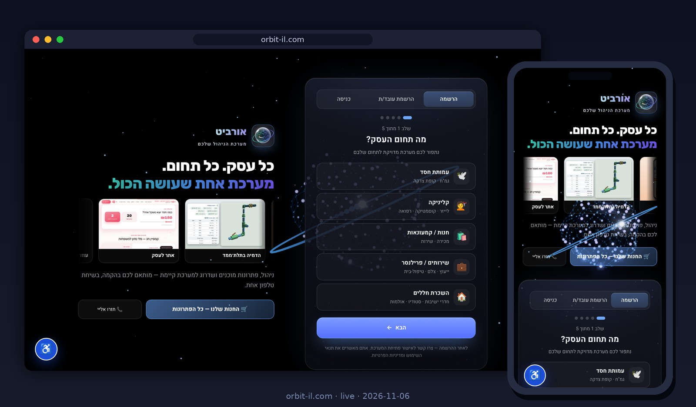

<p align="center"><a href="https://orbit-il.com"><b>🚀 Try it now: orbit-il.com</b></a> · <a href="#live-site-screenshot">Screenshot</a> · <a href="README.md">עברית</a></p>

<p align="center">
<picture>
<source media="(prefers-color-scheme: light)" srcset="assets/hero-light.svg">

</picture>
</p>

<p align="center">
<a href="https://github.com/meir7651231-ui/orbit-il/actions/workflows/deploy.yml"></a>
<a href="https://orbit-il.com/version.json"></a>

<a href="https://github.com/meir7651231-ui/orbit-il/tree/gh-pages"></a>
</p>

<h3 align="center">No product code here. One path only: from <code>maor-system@main</code> to live, at orbit-il.com.</h3>

<p align="center"><a href="#what-it-does"><b>What it does</b></a> · <a href="#when-it-runs">When it runs</a> · <a href="#run-it-manually">Run manually</a> · <a href="#verify-a-deploy-in-30-seconds">Verify</a> · <a href="#what-it-does-not-do">What it does not do</a> · <a href="#faq">FAQ</a> · <a href="docs/RUNBOOK.md">Runbook</a> · <a href="#layout">Layout</a> · <a href="#do-not-touch">Do not touch</a></p>

### Live site screenshot

<p align="center"><a href="https://orbit-il.com"></a></p>
<p align="center"><sub>This is what the repo serves — a real screenshot of orbit-il.com, desktop and mobile (2026-11-06).</sub></p>

---

## What it does

This repo **builds and serves the live site [orbit-il.com](https://orbit-il.com)**. The application code lives in `meir7651231-ui/maor-system`; this repo holds only the deploy path:

<p align="center">
<picture>
<source media="(prefers-color-scheme: light)" srcset="assets/deploy-flow-light.svg">

</picture>
</p>

1. **Trigger** — one of the three sources below starts the `Build Orbit from maor-system` workflow.
2. **Checkout** — `actions/checkout` pulls `maor-system` at `main`.
3. **Build** — Node 22, `npm ci`, `npm run build` → `dist/`.
4. **Publish** — `CNAME` (`orbit-il.com`) and `.nojekyll` are written, and `dist/` is force-pushed to this repo's `gh-pages` branch.
5. **Live** — GitHub Pages serves `gh-pages` at orbit-il.com.

## When it runs

| Trigger | When | Note |
|---|---|---|
| ⏰ `schedule` | daily at **03:00 UTC** | ships whatever was merged to `maor-system@main` |
| 📌 `push` | every push to `main` **in this repo** | the "deploy now" path: add an entry to [`DEPLOY-LOG.md`](DEPLOY-LOG.md) and push |
| ▶️ `workflow_dispatch` | manually, from the Actions tab | see below |

<p align="center">
<picture>
<source media="(prefers-color-scheme: light)" srcset="assets/deploy-timeline-light.svg">

</picture>
</p>

> ⚠️ Every merge to `main` here — **documentation changes included** — rebuilds and redeploys the live site from the current `maor-system@main`.

## Run it manually

1. Open [**Actions → Build Orbit from maor-system**](https://github.com/meir7651231-ui/orbit-il/actions/workflows/deploy.yml).
2. Click **Run workflow** → branch `main` → **Run workflow**.
3. Wait for the green check (about a minute), then for the `pages build and deployment` run (another minute).

## Verify a deploy in 30 seconds

```console
$ curl -s "https://orbit-il.com/version.json?t=$(date +%s)"
{"id":"2026-11-06T10:02:48.801Z"}
```

<sub>Real output, 2026-11-06. `id` = build time (UTC). `?t=` skips the cache: the server sends `cache-control: max-age=600`, so without it you may see the previous version for up to 10 minutes.</sub>

1. **Is the `id` later than the run's start in [Actions](https://github.com/meir7651231-ui/orbit-il/actions/workflows/deploy.yml)?** — the live site is up to date. ✅
2. **No?** — wait for `pages build and deployment` to finish (about a minute) and check again.
3. **Still no?** — [Runbook → Diagnose a failure](docs/RUNBOOK.md#diagnose-a-failure).

## What it does not do

- **No product code.** The app, its tests and its fixes live in `maor-system`. A site change starts there, not here.
- **It does not deploy right after a merge in `maor-system`.** Nothing links the two repos: a merge there goes live at the next 03:00 UTC run — **up to 24 hours** — unless you trigger a deploy here.
- **It does not test the site.** The workflow builds and publishes; a green run means the build passed, not that the site works.
- **It keeps no previous versions.** `gh-pages` is overwritten on every run; rolling back means rebuilding from an older `maor-system` commit.
- **It never builds another branch.** Always `maor-system@main`, manual runs included.

## FAQ

<details><summary><b>I merged in maor-system and the site hasn't changed. Why?</b></summary>

The automatic build runs once a day, at 03:00 UTC. To ship now: Actions → Run workflow, or add an entry to `DEPLOY-LOG.md` and push to `main` here. Then check `version.json`.
</details>

<details><summary><b>The run is green but the site is still old.</b></summary>

After Build Orbit, a second run — `pages build and deployment` — takes about another minute. Then hard-refresh the browser (the app is a PWA and may hold a cached copy). `version.json` shows what is really live.
</details>

<details><summary><b>The run failed. What now?</b></summary>

Almost always the failure is in `maor-system`'s `npm ci` or `npm run build` — the problem is on its `main`. The live site is not affected: `gh-pages` only updates when the build succeeds. Fix it in `maor-system` and run again.
</details>

<details><summary><b>Can I edit a file directly on gh-pages?</b></summary>

No. The branch is force-pushed on every run, so a hand edit is gone by morning.
</details>

<details><summary><b>Why does a README change here trigger a deploy?</b></summary>

The workflow runs on every push to `main`, with no path filter. That is what makes "deploy now" possible — and it means every merge here ships `maor-system@main` as it is at that moment.
</details>

## Layout

| File / folder | Role |
|---|---|
| `.github/workflows/deploy.yml` | the build & deploy path (owner approval to change) |
| `DEPLOY-LOG.md` | manual-deploy log; entry + push = deploy now |
| `README.md` · `README.en.md` | this document, in Hebrew and English |
| `CHANGELOG.md` | repo history |
| `SECURITY.md` | permissions, secrets, reporting |
| `CONTRIBUTING.md` | how to propose a change to this repo |
| `docs/RUNBOOK.md` | runbook: manual run, diagnosing a failure, rollback |
| `.github/ISSUE_TEMPLATE/` · `.github/pull_request_template.md` | issue and PR templates (they don't touch workflows) |
| `assets/` | illustrations (dark + `-light`) and the live-site screenshot |

`gh-pages` is recreated on every run (force push) — never edit it by hand.

## Do not touch

- `.github/workflows/` — a change can take the live site down.
- The `gh-pages` branch and `CNAME` — written automatically; hand edits are overwritten, and a CNAME change detaches the domain.
- `DEPLOY-LOG.md` — a historical log; append only.
- Direct pushes to `main` — they deploy. Work on a branch + PR.

<details>
<summary>Old trigger history (Aug–Sep 2026)</summary>

Until September 2026 a "deploy now" was done by adding a line to the README. The lines are kept here as they were; since October, entries go to [`DEPLOY-LOG.md`](DEPLOY-LOG.md).

```
Last manual deploy trigger: 2026-08-23 (plans.html go-live)
Redeploy trigger: 2026-08-24 (remove plans.html)

Redeploy trigger: 2026-09-03 (deep-audit #473 — orbit-il.com lagged 24h+ behind main; permanent fix pending owner: move custom domain to maor-system Pages)
Redeploy trigger: 2026-09-03b (#474 leftovers)
Redeploy trigger: 2026-09-03c (#475 swarm-b)
Redeploy trigger: 2026-09-03d (#476 ayin board)
Redeploy trigger: 2026-09-03e (#477 ayin align)
Redeploy trigger: 2026-09-05 (#478 segula + board done)
Redeploy trigger: 2026-09-05b (#479 version line + PWA update check)
Redeploy trigger: 2026-09-06 (#480 prayer names + scroll memory)
Redeploy trigger: 2026-09-06b (#481 member display names)
Redeploy trigger: 2026-09-06c (#482 ayin region filter)
- trigger 2026-09-06 · maor #483 segula panel
- trigger 2026-09-06 · maor #484 last-donation filter
- trigger 2026-09-09 · maor #486 #487 (batch A+B)
- trigger 2026-09-10 · maor #489 segula active bar
- trigger 2026-09-10 · maor #490 filter memory
- trigger 2026-09-14 · maor #492 demo purge
- trigger 2026-09-16 · maor #494 teachers csv + segula diag
- trigger 2026-09-16 · maor #496 recur chooser
- 2026-09-17 · build trigger · maor #498 (care-back memory)
- 2026-09-23 · build trigger · maor #501 (segula default-on)
```
</details>

---

<p align="center"><sub><a href="docs/RUNBOOK.md">RUNBOOK</a> · <a href="CHANGELOG.md">CHANGELOG</a> · <a href="CONTRIBUTING.md">CONTRIBUTING</a> · <a href="SECURITY.md">SECURITY</a> · <a href="DEPLOY-LOG.md">DEPLOY-LOG</a></sub></p>
