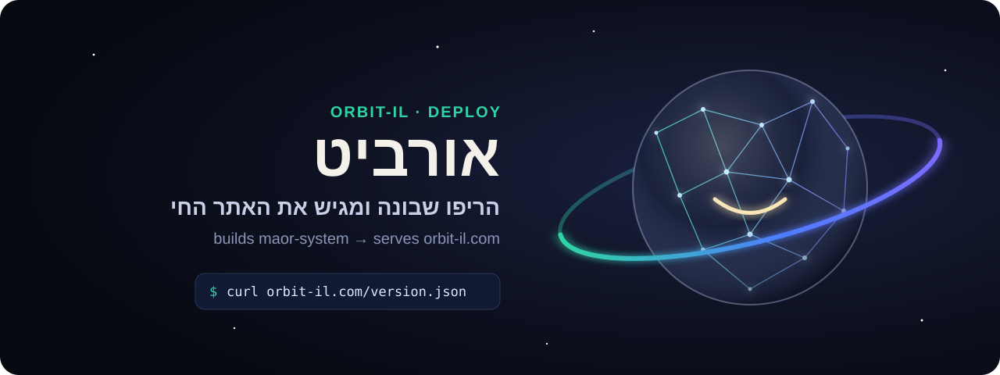
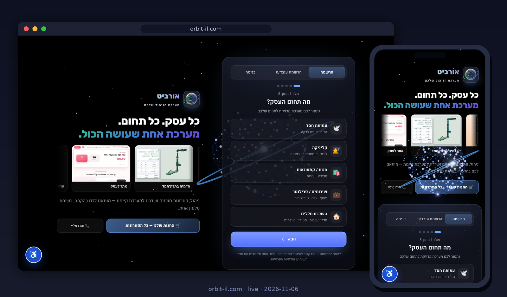
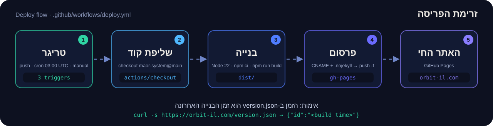
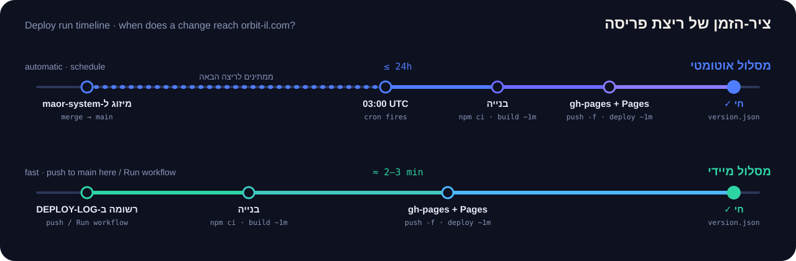

<p align="right"><b>English</b> · <a href="README.md">עברית</a></p>

<p align="center"></p>

<p align="center">
<a href="https://github.com/meir7651231-ui/orbit-il/actions/workflows/deploy.yml"></a>
<a href="https://orbit-il.com"></a>


</p>

<h3 align="center">No product code here. One path only: from <code>maor-system@main</code> to live, at orbit-il.com.</h3>

<p align="center"><a href="#what-it-does"><b>What it does</b></a> · <a href="#when-it-runs">When it runs</a> · <a href="#run-it-manually">Run manually</a> · <a href="#verify">Verify</a> · <a href="#what-it-does-not-do">What it does not do</a> · <a href="#faq">FAQ</a> · <a href="#layout">Layout</a> · <a href="#do-not-touch">Do not touch</a></p>

<p align="center"><a href="https://orbit-il.com"></a></p>
<p align="center"><sub>This is what the repo serves — a real screenshot of orbit-il.com, desktop and mobile (2026-11-06).</sub></p>

---

## What it does

This repo **builds and serves the live site [orbit-il.com](https://orbit-il.com)**. The application code lives in `meir7651231-ui/maor-system`; this repo holds only the deploy path:

<p align="center"></p>

1. **Trigger** — one of the three sources below starts the `Build Orbit from maor-system` workflow.
2. **Checkout** — `actions/checkout` pulls `maor-system` at `main`.
3. **Build** — Node 22, `npm ci`, `npm run build` → `dist/`.
4. **Publish** — `CNAME` (`orbit-il.com`) and `.nojekyll` are written, and `dist/` is force-pushed to this repo's `gh-pages` branch.
5. **Live** — GitHub Pages serves `gh-pages` at orbit-il.com.

## When it runs

| Trigger | When | Note |
|---|---|---|
| ⏰ `schedule` | daily at **03:00 UTC** | ships whatever was merged to `maor-system@main` |
| 📌 `push` | every push to `main` **in this repo** | the "deploy now" path: add an entry to [`DEPLOY-LOG.md`](DEPLOY-LOG.md) and push |
| ▶️ `workflow_dispatch` | manually, from the Actions tab | see below |

<p align="center"></p>

> ⚠️ Every merge to `main` here — **documentation changes included** — rebuilds and redeploys the live site from the current `maor-system@main`.

## Run it manually

1. Open [**Actions → Build Orbit from maor-system**](https://github.com/meir7651231-ui/orbit-il/actions/workflows/deploy.yml).
2. Click **Run workflow** → branch `main` → **Run workflow**.
3. Wait for the green check (about a minute), then for the `pages build and deployment` run (another minute).

## Verify

```bash
curl -s https://orbit-il.com/version.json
# {"id":"2026-11-06T10:02:48.801Z"}  ← time of the last build (UTC)
```

If the time in `version.json` is later than the run's start, the live site is up to date. You can also compare it with the latest run in [Actions](https://github.com/meir7651231-ui/orbit-il/actions).

## What it does not do

- **No product code.** The app, its tests and its fixes live in `maor-system`. A site change starts there, not here.
- **It does not deploy right after a merge in `maor-system`.** Nothing links the two repos: a merge there goes live at the next 03:00 UTC run — **up to 24 hours** — unless you trigger a deploy here.
- **It does not test the site.** The workflow builds and publishes; a green run means the build passed, not that the site works.
- **It keeps no previous versions.** `gh-pages` is overwritten on every run; rolling back means rebuilding from an older `maor-system` commit.
- **It never builds another branch.** Always `maor-system@main`, manual runs included.

## FAQ

<details><summary><b>I merged in maor-system and the site hasn't changed. Why?</b></summary>

The automatic build runs once a day, at 03:00 UTC. To ship now: Actions → Run workflow, or add an entry to `DEPLOY-LOG.md` and push to `main` here. Then check `version.json`.
</details>

<details><summary><b>The run is green but the site is still old.</b></summary>

After Build Orbit, a second run — `pages build and deployment` — takes about another minute. Then hard-refresh the browser (the app is a PWA and may hold a cached copy). `version.json` shows what is really live.
</details>

<details><summary><b>The run failed. What now?</b></summary>

Almost always the failure is in `maor-system`'s `npm ci` or `npm run build` — the problem is on its `main`. The live site is not affected: `gh-pages` only updates when the build succeeds. Fix it in `maor-system` and run again.
</details>

<details><summary><b>Can I edit a file directly on gh-pages?</b></summary>

No. The branch is force-pushed on every run, so a hand edit is gone by morning.
</details>

<details><summary><b>Why does a README change here trigger a deploy?</b></summary>

The workflow runs on every push to `main`, with no path filter. That is what makes "deploy now" possible — and it means every merge here ships `maor-system@main` as it is at that moment.
</details>

## Layout

```
orbit-il/
├── .github/workflows/deploy.yml   ← the build & deploy path (owner approval to change)
├── DEPLOY-LOG.md                  ← manual-deploy log; entry + push = deploy now
├── README.md / README.en.md       ← this document
├── CHANGELOG.md                   ← repo history by month
├── SECURITY.md                    ← permissions, secrets, reporting
└── assets/                        ← hero.svg, live-site.png, deploy-flow.svg, deploy-timeline.svg
```

`gh-pages` is recreated on every run (force push) — never edit it by hand.

## Do not touch

- `.github/workflows/` — a change can take the live site down.
- The `gh-pages` branch and `CNAME` — written automatically; hand edits are overwritten, and a CNAME change detaches the domain.
- `DEPLOY-LOG.md` — a historical log; append only.
- Direct pushes to `main` — they deploy. Work on a branch + PR.

The pre-October trigger lines that used to live in this README are kept, unchanged, at the bottom of the [Hebrew README](README.md).

---

<p align="center"><sub><a href="CHANGELOG.md">CHANGELOG</a> · <a href="SECURITY.md">SECURITY</a> · <a href="DEPLOY-LOG.md">DEPLOY-LOG</a></sub></p>
