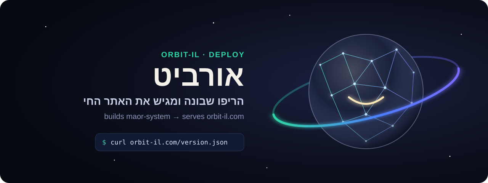
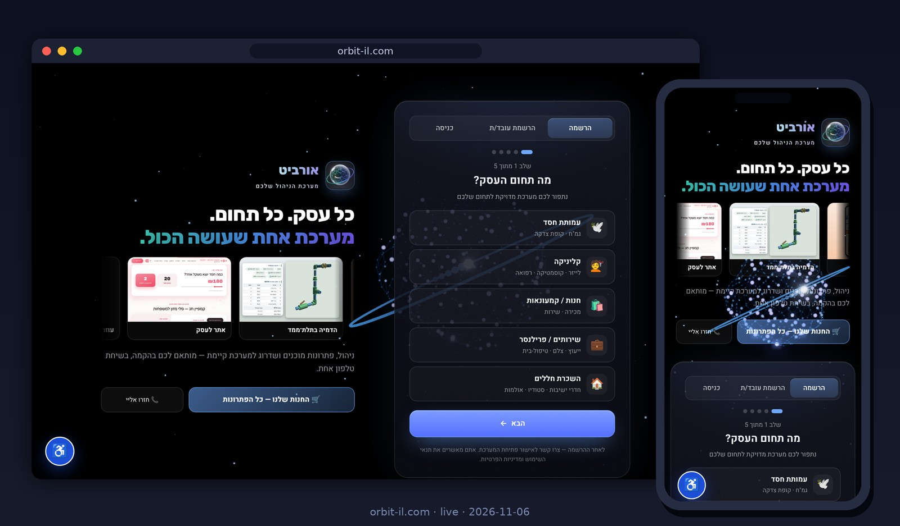
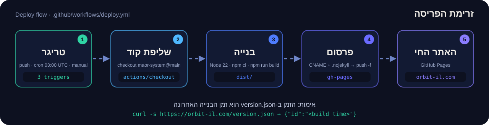
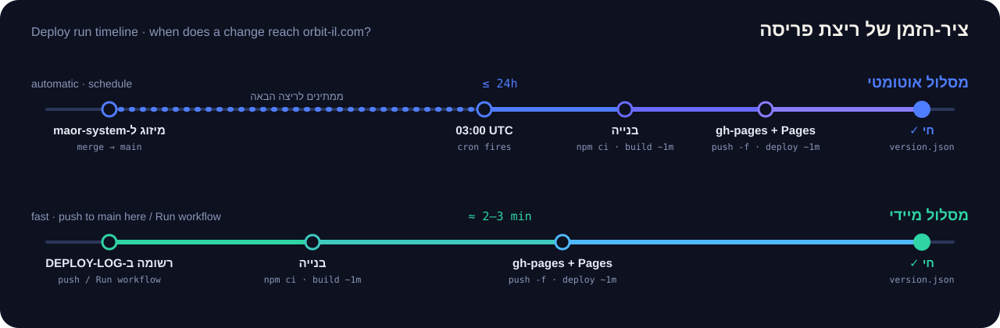

<p align="center"><a href="https://orbit-il.com"><b>🚀 נסו עכשיו: orbit-il.com</b></a> · <a href="#צילום-האתר-החי">צילום</a> · <a href="README.en.md">English</a></p>

<p align="center">
<picture>
<source media="(prefers-color-scheme: light)" srcset="assets/hero-light.svg">

</picture>
</p>

<p align="center">
<a href="https://github.com/meir7651231-ui/orbit-il/actions/workflows/deploy.yml"></a>
<a href="https://orbit-il.com/version.json"></a>

<a href="https://github.com/meir7651231-ui/orbit-il/tree/gh-pages"></a>
</p>

<h3 align="center">אין כאן קוד-מוצר. יש כאן מסלול אחד: מ-<code>maor-system@main</code> לאוויר, ב-orbit-il.com.</h3>

<p align="center"><a href="#מה-הריפו-עושה"><b>מה הוא עושה</b></a> · <a href="#מתי-הוא-רץ">מתי רץ</a> · <a href="#הרצה-ידנית">הרצה ידנית</a> · <a href="#אימות-פריסה-תוך-30-שניות">אימות</a> · <a href="#מה-הוא-לא-עושה">מה הוא לא עושה</a> · <a href="#שאלות-נפוצות">שאלות נפוצות</a> · <a href="docs/RUNBOOK.md">ספר-הפעלה</a> · <a href="#מבנה-הריפו">מבנה</a> · <a href="#מה-אסור-לגעת">מה אסור</a></p>

### צילום האתר החי

<p align="center"><a href="https://orbit-il.com"></a></p>
<p align="center"><sub>זה מה שהריפו הזה מגיש — צילום אמיתי של orbit-il.com, במחשב ובנייד (6.11.2026).</sub></p>

---

## מה הריפו עושה

הריפו הזה **בונה ומגיש את האתר החי [orbit-il.com](https://orbit-il.com)**. קוד האפליקציה עצמו יושב בריפו `meir7651231-ui/maor-system`; כאן יש רק את מסלול-הפריסה:

<p align="center">
<picture>
<source media="(prefers-color-scheme: light)" srcset="assets/deploy-flow-light.svg">

</picture>
</p>

1. **טריגר** — אחד משלושת המקורות למטה מפעיל את ה-workflow ‏`Build Orbit from maor-system`.
2. **שליפת קוד** — `actions/checkout` מושך את `maor-system` מענף `main`.
3. **בנייה** — Node 22, ‏`npm ci`, ‏`npm run build` → תיקיית `dist/`.
4. **פרסום** — נכתבים `CNAME` (‏`orbit-il.com`) ו-`.nojekyll`, ו-`dist/` נדחף בכוח (force) לענף `gh-pages` של הריפו הזה.
5. **האתר החי** — GitHub Pages מגיש את `gh-pages` בדומיין orbit-il.com.

## מתי הוא רץ

| טריגר | מתי | הערה |
|---|---|---|
| ⏰ `schedule` | כל יום ב-**03:00 UTC** (‏05:00/06:00 שעון ישראל) | מעלה אוטומטית את מה שמוזג ל-`maor-system@main` |
| 📌 `push` | כל דחיפה ל-`main` **בריפו הזה** | כך נעשית "פריסה מיידית": מוסיפים רשומה ל-[`DEPLOY-LOG.md`](DEPLOY-LOG.md) ודוחפים |
| ▶️ `workflow_dispatch` | ידנית, מלשונית Actions | ראו למטה |

<p align="center">
<picture>
<source media="(prefers-color-scheme: light)" srcset="assets/deploy-timeline-light.svg">

</picture>
</p>

> ⚠️ כל מיזוג ל-`main` כאן — **גם של שינוי תיעוד** — מפעיל בנייה ופריסה מחדש של האתר החי מ-`maor-system@main` הנוכחי.

## הרצה ידנית

1. נכנסים ל-[**Actions ← Build Orbit from maor-system**](https://github.com/meir7651231-ui/orbit-il/actions/workflows/deploy.yml).
2. לוחצים **Run workflow** ← ענף `main` ← **Run workflow**.
3. מחכים לוי ירוק (כדקה), ואחריו לריצת `pages build and deployment` (עוד כדקה).

## אימות פריסה תוך 30 שניות

```console
$ curl -s "https://orbit-il.com/version.json?t=$(date +%s)"
{"id":"2026-11-06T10:02:48.801Z"}
```

<sub>פלט אמיתי, 6.11.2026. `id` = זמן הבנייה (UTC). `?t=` עוקף את המטמון: השרת מחזיר `cache-control: max-age=600`, כך שבלי זה אפשר לראות עד 10 דקות את הגרסה הקודמת.</sub>

1. **הזמן ב-`id` מאוחר מתחילת הריצה ב-[Actions](https://github.com/meir7651231-ui/orbit-il/actions/workflows/deploy.yml)?** — האתר החי מעודכן. ✅
2. **לא?** — מחכים לסיום `pages build and deployment` (כדקה) ובודקים שוב.
3. **ועדיין לא?** — [ספר-ההפעלה ← אבחון כשל](docs/RUNBOOK.md#אבחון-כשל).

## מה הוא לא עושה

- **אין כאן קוד-מוצר.** האפליקציה, הבדיקות והתיקונים — כולם ב-`maor-system`. שינוי באתר מתחיל שם, לא כאן.
- **לא פורס מיד אחרי מיזוג ב-`maor-system`.** אין חיבור אוטומטי בין הריפואים: מיזוג שם עולה לאוויר רק בריצת 03:00 UTC הבאה — **עד 24 שעות** — אלא אם מפעילים פריסה מיידית כאן.
- **לא בודק את האתר.** ה-workflow בונה ומפרסם; אין בו בדיקות, וריצה ירוקה אומרת שהבנייה עברה, לא שהאתר תקין.
- **לא שומר גרסאות קודמות.** `gh-pages` נדרס בכל ריצה; חזרה לאחור = לבנות שוב מ-commit ישן יותר ב-`maor-system`.
- **לא בונה מענף אחר.** תמיד `maor-system@main`, גם בהרצה ידנית.

## שאלות נפוצות

<details dir="rtl"><summary><b>מיזגתי ב-maor-system ולא רואה את השינוי באתר. למה?</b></summary>

כי הבנייה האוטומטית רצה פעם ביום, ב-03:00 UTC. כדי להעלות עכשיו: Actions ← Run workflow, או רשומה חדשה ב-`DEPLOY-LOG.md` ודחיפה ל-`main` כאן. אחר כך בודקים ב-`version.json`.
</details>

<details dir="rtl"><summary><b>הריצה ירוקה אבל האתר עדיין ישן.</b></summary>

אחרי Build Orbit רצה עוד ריצה — `pages build and deployment` — שלוקחת כדקה נוספת. אחריה: רענון קשיח בדפדפן (האפליקציה היא PWA ועשויה להחזיק עותק שמור). `version.json` מראה מה באמת חי.
</details>

<details dir="rtl"><summary><b>הריצה נכשלה. מה עושים?</b></summary>

כמעט תמיד הכשל הוא ב-`npm ci` או `npm run build` של `maor-system` — כלומר הבעיה ב-main שם. האתר החי לא נפגע: `gh-pages` מתעדכן רק כשהבנייה הצליחה. מתקנים ב-`maor-system` ומריצים שוב.
</details>

<details dir="rtl"><summary><b>אפשר לערוך קובץ ישירות בענף gh-pages?</b></summary>

לא. הענף נדרס בכל ריצה (push בכוח), כך שכל עריכה ידנית תיעלם עד הבוקר.
</details>

<details dir="rtl"><summary><b>למה שינוי ב-README כאן מפעיל פריסה?</b></summary>

ה-workflow רץ על כל push ל-`main`, בלי סינון לפי קבצים. זה גם מה שמאפשר "פריסה מיידית" — אבל המשמעות היא שכל מיזוג כאן מעלה לאוויר את `maor-system@main` של אותו רגע.
</details>

## מבנה הריפו

| קובץ / תיקייה | תפקיד |
|---|---|
| ‏`.github/workflows/deploy.yml` | מסלול הבנייה והפריסה (לא נוגעים בלי אישור) |
| ‏`DEPLOY-LOG.md` | יומן פריסות ידניות; רשומה + push = פריסה מיידית |
| ‏`README.md` · `README.en.md` | המסמך הזה, בעברית ובאנגלית |
| ‏`CHANGELOG.md` | היסטוריית הריפו לפי חודשים |
| ‏`SECURITY.md` | הרשאות, סודות ודיווח |
| ‏`CONTRIBUTING.md` | איך מציעים שינוי בריפו הזה |
| ‏`docs/RUNBOOK.md` | ספר-הפעלה: הרצה ידנית, אבחון כשל, חזרה לאחור |
| ‏`.github/ISSUE_TEMPLATE/` · ‏`.github/pull_request_template.md` | תבניות ל-issue ול-PR (לא נוגעות ב-workflows) |
| ‏`assets/` | איורים (גרסה כהה + `-light`) וצילום האתר החי |

הענף `gh-pages` נוצר מחדש בכל ריצה (push בכוח) — אין לערוך בו ידנית.

## מה אסור לגעת

- **ה-workflow** (`.github/workflows/`) — שינוי שם עלול לשבור את האתר החי.
- **ענף** `gh-pages` וקובץ `CNAME` — נכתבים אוטומטית; עריכה ידנית תידרס, ושינוי CNAME מנתק את הדומיין.
- **יומן הפריסות** (`DEPLOY-LOG.md`) — יומן היסטורי; רק מוסיפים רשומות, לא מוחקים.
- **דחיפה ישירה** ל-`main` — מפעילה פריסה. עבודה בענף + PR.

<details>
<summary>היסטוריית טריגרים ישנה (אוג׳–ספט׳ 2026)</summary>

עד ספטמבר 2026 פריסה מיידית נעשתה בהוספת שורה לקובץ הזה. השורות נשמרות כאן כפי שהיו; מאז אוקטובר הרשומות נכתבות ל-[`DEPLOY-LOG.md`](DEPLOY-LOG.md).

```
Last manual deploy trigger: 2026-08-23 (plans.html go-live)
Redeploy trigger: 2026-08-24 (remove plans.html)

Redeploy trigger: 2026-09-03 (deep-audit #473 — orbit-il.com lagged 24h+ behind main; permanent fix pending owner: move custom domain to maor-system Pages)
Redeploy trigger: 2026-09-03b (#474 leftovers)
Redeploy trigger: 2026-09-03c (#475 swarm-b)
Redeploy trigger: 2026-09-03d (#476 ayin board)
Redeploy trigger: 2026-09-03e (#477 ayin align)
Redeploy trigger: 2026-09-05 (#478 segula + board done)
Redeploy trigger: 2026-09-05b (#479 version line + PWA update check)
Redeploy trigger: 2026-09-06 (#480 prayer names + scroll memory)
Redeploy trigger: 2026-09-06b (#481 member display names)
Redeploy trigger: 2026-09-06c (#482 ayin region filter)
- trigger 2026-09-06 · maor #483 segula panel
- trigger 2026-09-06 · maor #484 last-donation filter
- trigger 2026-09-09 · maor #486 #487 (batch A+B)
- trigger 2026-09-10 · maor #489 segula active bar
- trigger 2026-09-10 · maor #490 filter memory
- trigger 2026-09-14 · maor #492 demo purge
- trigger 2026-09-16 · maor #494 teachers csv + segula diag
- trigger 2026-09-16 · maor #496 recur chooser
- 2026-09-17 · build trigger · maor #498 (care-back memory)
- 2026-09-23 · build trigger · maor #501 (segula default-on)
```
</details>

---

<p align="center"><sub><a href="docs/RUNBOOK.md">RUNBOOK</a> · <a href="CHANGELOG.md">CHANGELOG</a> · <a href="CONTRIBUTING.md">CONTRIBUTING</a> · <a href="SECURITY.md">SECURITY</a> · <a href="DEPLOY-LOG.md">DEPLOY-LOG</a></sub></p>
